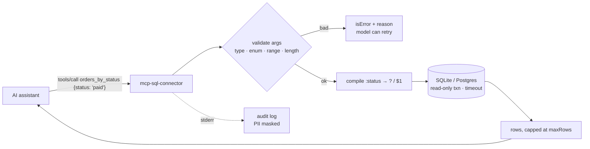

# mcp-sql-connector

An [MCP](https://modelcontextprotocol.io) server that lets an AI assistant (Claude Desktop, Cursor, any MCP client) answer questions from a SQL database **without ever writing SQL**.

The assistant picks a tool from a reviewed catalogue of named queries and supplies parameter values. The server validates those values, binds them as positional parameters and runs the fixed statement. Nothing the model sends can change the SQL.



## Why a catalogue instead of text-to-SQL

Letting a model write free-form SQL against production data means trusting it with every table, every column and the query planner. A catalogue keeps the parts that matter under code review:

| Guard | How |
|---|---|
| No SQL injection | Only `:name` placeholders; values are bound positionally (`?` for SQLite, `$1` for Postgres) |
| One statement per query | Catalogue load fails if a query contains `;` outside a string or comment |
| Read-only by default | Writes must be marked `"write": true` **and** the server started with `--allow-writes`; write tools are hidden otherwise. SQLite opens read-only; Postgres runs reads in `BEGIN READ ONLY` |
| Typed arguments | `string · integer · number · boolean · date` with `enum`, `min`, `max`, `maxLength`; unknown arguments are rejected |
| Bounded results | Per-query `maxRows` (default 100, hard cap 1000); the response says when it was cut off |
| Bounded time | Postgres `statement_timeout` per call (`--timeout-ms`, default 5000) |
| Auditable | One JSON line per call on stderr: tool, args, row count, duration. Params marked `"pii": true` are masked |
| Safe errors | Argument errors explain what to fix; database errors are not echoed back to the model |

The catalogue is checked when the server starts: every placeholder must be declared, every declared parameter must be used, names must be `snake_case`, and anything that looks like a write (`INSERT`, `UPDATE`, `DELETE`, `DROP`, writable CTEs, …) must be marked as one.

## Quick start

Requires Node.js 22.18+ (runs TypeScript directly; SQLite is built in). No `npm install` needed for SQLite.

```bash
node examples/make-db.ts     # builds examples/shop.db from seed.sql (fictional store data)
npm test                     # 20 tests: catalogue rules, compiler, server, stdio end-to-end
```

Talk to it by hand:

```bash
echo '{"jsonrpc":"2.0","id":1,"method":"tools/call","params":{"name":"top_customers","arguments":{"limit":3}}}' \
  | node src/server.ts --catalog examples/queries.json --sqlite examples/shop.db
```

### Use it from Claude Desktop

Add this to `claude_desktop_config.json` (see `examples/claude_desktop_config.json`) and restart:

```json
{
  "mcpServers": {
    "shop-sql": {
      "command": "node",
      "args": ["/path/to/mcp-sql-connector/src/server.ts",
               "--catalog", "/path/to/mcp-sql-connector/examples/queries.json",
               "--sqlite",  "/path/to/mcp-sql-connector/examples/shop.db"]
    }
  }
}
```

Then ask things like *"Which city brought in the most revenue in March?"* or *"Show me refunded orders."*

### Postgres

```bash
npm install pg
node src/server.ts --catalog queries.json --postgres "postgres://readonly_user@localhost/shop" --timeout-ms 3000
```

Use a database role that only has `SELECT` on the tables the catalogue needs — the server's checks are a second line of defence, not the first.

## Writing a catalogue

```json
{
  "name": "revenue_by_city",
  "description": "Paid and shipped revenue per customer city between two dates (inclusive).",
  "sql": "SELECT c.city, SUM(o.total_paise)/100.0 AS revenue_inr FROM orders o JOIN customers c ON c.id = o.customer_id WHERE o.placed_at BETWEEN :from AND :to GROUP BY c.city",
  "params": {
    "from": { "type": "date", "required": true },
    "to":   { "type": "date", "required": true }
  },
  "maxRows": 50
}
```

The `description` is what the model reads when choosing a tool, so write it for the model: what the query answers, the units, and the date range semantics.

## Project layout

```
src/catalog.ts           catalogue validation, argument checks, :name → ?/$n compiler, JSON Schema
src/server.ts            JSON-RPC 2.0 over stdio: initialize, ping, tools/list, tools/call; CLI
src/drivers/sqlite.ts    node:sqlite, read-only open, row cap via iterator
src/drivers/postgres.ts  pg pool, READ ONLY transaction, statement_timeout, LIMIT n+1 wrap
examples/                fictional shop schema, seed data, sample catalogue, Claude Desktop config
test/                    node:test suites
```

The protocol layer is hand-written (about 100 lines) rather than using the SDK, so it's easy to see exactly what an MCP server does: answer `initialize`, list tools with JSON Schemas, and return `content` blocks with `isError` for tool calls.

## Limits

- Placeholders inside string literals in catalogue SQL are still treated as placeholders; don't write `':x'` as a literal.
- The write-detection regex is a guard rail for catalogue authors, not a SQL parser. Database permissions are the real boundary.
- No resources/prompts capabilities yet — tools only.

## License

MIT
